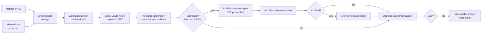

# n8n CRM → Mailchimp Weekly Sync

An [n8n](https://n8n.io) workflow that replaces a weekly manual task: **export all leads from the Close CRM, clean the list and import it into a Mailchimp audience**. After each run it creates a short **review task in Asana** with the numbers.

Published as an **anonymised** reference implementation (see [Sanitisation](#sanitisation)). Node names and code comments are in **German**; a [glossary](#glossary-german--english) is at the end.

---

## The manual process it replaces

1. Export all leads from Close as CSV ("common fields").
2. In Excel keep only first name, last name and e-mail of the primary contact.
3. Paste into Mailchimp → *Add contacts → Import*, audience "Newsletter", status *Subscribed*, "update existing contacts and un-archive".

Rules from the person doing it: contacts without an e-mail address are dropped, "no name" stays, a contact named "Slack" gets an empty name.

## What the workflow does



| Lane | Nodes | Details |
|---|---|---|
| 1 · Read and prepare | `Einstellungen`, `Zielgruppe prüfen`, `Close Leads holen`, `Kontakte aufbereiten` | Close API `GET /api/v1/lead/` with `_skip`/`_limit` pagination until `has_more` is false. Per lead the **primary contact** (first contact) and its first e-mail are used. Drops leads without contact, contacts without e-mail, invalid and duplicate addresses. Splits the single Close name field at the last space into first/last name. The run aborts if pages are missing or zero leads come back. |
| 2 · Mailchimp | `In Mailchimp eintragen`, `Archivierte …` | One `PUT /lists/{id}/members/{md5(email)}` per contact with `status_if_new: subscribed`: new contacts are subscribed, existing ones only get their names updated, **unsubscribed contacts stay unsubscribed**. Names are only sent when present, so an empty name never overwrites an existing one. Contacts that Mailchimp reports as `archived` are re-subscribed in a second step. Max. 5 parallel requests (Mailchimp allows 10 concurrent connections). Individual failures (e.g. "looks fake", compliance state) are counted, not fatal. |
| 3 · Asana | `Prüfaufgabe für UserA anlegen` | Creates a task "Newsletter sync … CW nn/yyyy: check and tick off" with the summary in the description, due the same day. |

Example summary written into the task:

```
Automatischer Abgleich Close → Mailchimp (05.01.2026 07:04):
• Close: 1000 Leads gelesen, 900 Kontakte übernommen
• Weggelassen: 60 ohne E-Mail, 5 ohne Kontakt, 0 mit ungültiger E-Mail, 35 doppelt; bei 1 „Slack“ als Name leer gelassen
• Mailchimp „Newsletter“: 4 neu abonniert, 896 aktualisiert, davon 200 abgemeldet (bleiben abgemeldet), …
(example numbers)
```

## Safety switches

- `live` in `Einstellungen`: when `false`, even the scheduled run only reads and counts.
- A **manual start is always a dry run** – it reads Close and the audience but never writes to Mailchimp or Asana.
- Credentials are plain *Basic Auth* credentials restricted to their own domain in n8n (`api.close.com`, `<dc>.api.mailchimp.com`).
- Errors go to an *error workflow* (e.g. an Asana task for the administrator).

## Setup

1. Import `workflows/crm_to_mailchimp_weekly.json`.
2. Create two **Basic Auth** credentials in n8n:

   | Name | User | Password | Allowed domain |
   |---|---|---|---|
   | Close (API) | Close API key (`api_…`) | *(empty)* | `api.close.com` |
   | Mailchimp (API) | any string | Mailchimp API key | `usXX.api.mailchimp.com` |

   plus an **Asana OAuth2** credential.
3. In `Einstellungen` set `mailchimp.rechenzentrum` (the data-center part of your Mailchimp URL, e.g. `us21`), `mailchimp.zielgruppe` (audience ID) and the Asana workspace/project/assignee IDs.
4. Run it manually (dry run) and check the summary in the `Ergebnis zusammenfassen` node.
5. Set `live: true` and activate the workflow.

## Placeholders to replace

| Placeholder | Meaning |
|---|---|
| `YOUR_AUDIENCE_ID`, `usXX` | Mailchimp audience ID and data center |
| `YOUR_ASANA_WORKSPACE_GID`, `YOUR_ASANA_NEWSLETTER_PROJECT_GID`, `YOUR_ASANA_USER_A_GID` | Asana IDs |
| `CREDENTIAL_ID_xx`, `WORKFLOW_ID_xx` | n8n credential and error-workflow IDs |
| `UserA` | the person who reviews the weekly task |

## Sanitisation

Company names, people, e-mail addresses, Asana/Mailchimp IDs, n8n credential and workflow IDs were replaced with placeholders; the repository starts with a single commit without the original history.

## Glossary German → English

| German | English |
|---|---|
| Einstellungen | settings |
| Zielgruppe | audience |
| Kontakte aufbereiten | prepare contacts |
| Schreiben? / Live? | write? / live? |
| In Mailchimp eintragen | upsert into Mailchimp |
| Archivierte reaktivieren | re-subscribe archived contacts |
| Ergebnis zusammenfassen | build summary |
| Prüfaufgabe | review task |
| Trockenlauf | dry run |
| abgemeldet | unsubscribed |
| Weggelassen | dropped |
